# Paulo Nobre Junior

Backend Software Engineer | Scalable SaaS Platforms & RESTful APIs | Rio de Janeiro, Brazil 🇧🇷 (Remote)

**LinkedIn**: [linkedin.com/in/paulonobrejr](https://linkedin.com/in/paulonobrejr) · **Email**: [paulonobrejunior@outlook.com](mailto:paulonobrejunior@outlook.com)

---

## About

Backend-focused Software Engineer with 5+ years building scalable SaaS platforms and RESTful APIs in PHP/Laravel and Node.js. Proven track record delivering measurable impact across distributed, international teams:

- Reduced manual operations by 70% on an international logistics SaaS platform
- Built real-time dashboards processing 10,000+ records with sub-second performance
- Cut dashboard load time from 3.2s to 0.8s by resolving N+1 queries and implementing strategic indexing
- Improved application performance by 25% across distributed teams

---

## Tech Stack

**Backend**: PHP 8.x · Laravel · Node.js · Express.js · REST APIs · GraphQL

**Databases & Caching**: MySQL · PostgreSQL · MongoDB · Redis

**Frontend**: Vue.js · React · Next.js · TypeScript

**DevOps & Infrastructure**: Docker · AWS (EC2, S3, RDS) · CI/CD · GitHub Actions

**Architecture & Practices**: Microservices · SOLID · RBAC · Multi-Tenancy · System Design · API Design · OWASP Security Standards

---

## GitHub Stats

---

## Let's Connect

Open to backend and full-stack engineering opportunities. Always glad to talk software architecture, system design, and distributed systems. Reach out via [LinkedIn](https://linkedin.com/in/paulonobrejr) or [email](mailto:paulonobrejunior@outlook.com).
